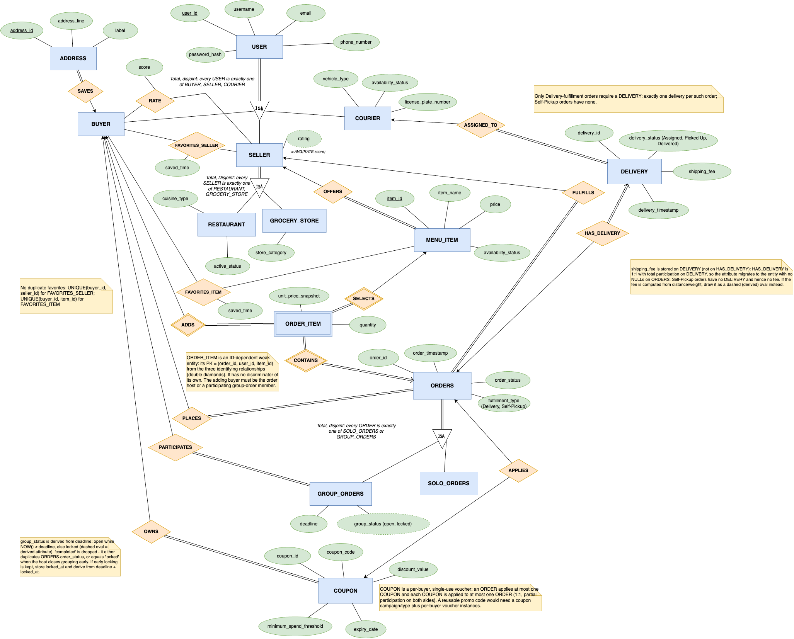

# COMP3278gp

**English** | [简体中文](README.zh-CN.md)

**Group Eats (foodpanda)** — COMP3278 final project.

Buyers place individual orders or create and join group orders. Each member adds their own items. The application is a local Flask website connected to MySQL. The browser never connects to the database directly.

The schema contains **18 tables and 2 views**. The running application supports login, store and menu browsing, individual and group orders, item CRUD, favourites, coupons, place/cancel, order history, and simulated completion.

## Requirements

- Python 3.10 or later
- MySQL 8.0.16 or later (CHECK constraints must be enforced)
- A MySQL account that can create a database and tables

No Node.js or separate static server is required. Flask serves the web pages and the API together.

## 1. Install the application

**Linux / macOS / WSL:**

```bash
python3 -m venv .venv
source .venv/bin/activate
pip install -r requirements.txt
cp .env.example .env
```

**Windows PowerShell:**

```powershell
py -m venv .venv
.\.venv\Scripts\Activate.ps1
python -m pip install -r requirements.txt
Copy-Item .env.example .env
```

Copy `.env.example` only on first setup. Do not overwrite an existing `.env`.

## 2. Configure the database connection

Edit `.env`:

| Variable | Purpose | Example |
|---|---|---|
| `SECRET_KEY` | Flask session secret | generate with `python -c "import secrets; print(secrets.token_hex(32))"` |
| `MYSQL_HOST` | MySQL host | `127.0.0.1` |
| `MYSQL_PORT` | MySQL port | `3306` |
| `MYSQL_USER` | MySQL user | `root` |
| `MYSQL_PASSWORD` | MySQL password | the password set when MySQL was installed |
| `MYSQL_DATABASE` | Empty target database name | `group_eats` |
| `PORT` | Website port | `5000` |

`DELIVERY_FEE_CENTS` defaults to `1000` (HK$10.00). `DEMO_COURIER_USER_ID` defaults to seeded courier `90201`.

## 3. Create the schema and load sample data

Start the MySQL server, then from the repository root:

```bash
python -m backend.manage init
```

`init` does the following in the database named by `MYSQL_DATABASE`:

1. Creates the database if it does not exist.
2. Runs `db/schema.sql` (18 tables and 2 views).
3. Imports `db/seed.sql` (162 related records).
4. Sets usable password hashes for the two demo buyers.

It refuses a database that already contains tables and does not delete an existing application database. To reproduce from scratch, use a new empty `MYSQL_DATABASE` name.

The seed data includes buyers, sellers, menu items, coupons, solo and group orders, favourites, ratings, and deliveries.

Alternative shell import (same schema and seed; then set demo passwords):

```bash
bash db/setup.sh
bash db/seed.sh
python -m backend.manage demo-accounts
```

`setup.sh` and `seed.sh` prompt for the MySQL password. Importing `seed.sql` alone leaves placeholder hashes until `demo-accounts` is run.

## 4. Run the application

```bash
python app.py
```

Open **http://127.0.0.1:5000**.

If that address is not the Group Eats site (on some macOS machines port 5000 is used by AirPlay), set `PORT=5001` in `.env`, restart `python app.py`, and open **http://127.0.0.1:5001**.

Leave the terminal running while using the site. Stop the server with Ctrl+C.

### Demo accounts

Local course demonstration only:

| Buyer | Email | Password |
|---|---|---|
| Alice | alice@example.com | DemoPass3278! |
| Bob | bob@example.com | DemoPass3278! |

There is no registration. Use Alice in a normal window and Bob in a private window to join the same group. Two ordinary tabs share one login.

Alice’s unused coupon code is `ALICE10` (minimum HK$30). Bob’s is `BOB5`. Apply the code on a pending order. A group coupon is applied by the host and reduces the host’s share only. After a group deadline, the host may still remove a coupon from a pending group, then place the order. Adding or replacing a coupon, and editing items, still require an open group.

## 5. Inspect the data

After a page action, query MySQL. Result grids do not refresh by themselves; run the SELECT again.

**MySQL Workbench:** connect to `127.0.0.1:3306` with the same user, password, and database as `.env`. Open a SQL tab and run:

```sql
SELECT DATABASE();
SHOW TABLES;
SELECT order_id, host_user_id, order_status, coupon_id
FROM orders
WHERE host_user_id = 90001
ORDER BY order_id DESC
LIMIT 10;
SELECT buyer_user_id, seller_user_id, saved_time
FROM favorite_sellers
WHERE buyer_user_id = 90001;
```

Alice is `user_id` `90001`. Harbour Cafe is seller `90101`.

**MySQL command line:**

```bash
mysql -h 127.0.0.1 -P 3306 -u root -p group_eats
```

Use the host, port, user, and database from `.env`.

## 6. Tests

With the virtual environment active, MySQL running, and `.env` configured:

```bash
python -m unittest discover -s tests -v
```

The suite creates a temporary `group_eats_test_*` database, imports the real schema and seed, then drops that test database. It does not clear `MYSQL_DATABASE`. The MySQL account needs `CREATE` and `DROP DATABASE` privileges. The suite contains 26 integration tests.

## How to use the site

1. Log in as Alice.
2. Open a store (the seed set used by the UI is 4 sellers and 9 items).
3. **Order for myself** creates an individual order, or **Start a group order** creates a group with a deadline.
4. Add, change, or remove items. Place the order, or cancel it before placement.
5. For a group, copy the invite link, log in as Bob in a private window, join, and add Bob’s own items.
6. Hearts save stores and dishes. Coupons are listed under Coupons and applied on a pending order.

Cancellation keeps the order row and sets `coupon_id` to NULL. Confirmed orders are read-only. Pending groups become read-only for joining and item edits at the deadline (Hong Kong time). The host may place a non-empty group before or after the deadline. Placement is not online payment.

## Database design

The schema follows [ER03](ER/ER03.png) ([draw.io source](ER/ER03.drawio)) and `db/schema.sql`.



| Table | Purpose |
|---|---|
| `users`, `buyers`, `sellers`, `couriers` | Accounts; each user has exactly one role |
| `restaurants`, `grocery_stores` | Seller subtypes |
| `addresses` | Saved buyer addresses (not selected at checkout) |
| `menu_items` | Seller catalogue |
| `coupons` | Per-buyer vouchers; at most one coupon per order |
| `orders`, `solo_orders`, `group_orders` | Shared order header and subtypes |
| `group_order_participants` | Group membership |
| `order_items` | Lines with `unit_price_snapshot` |
| `favorite_sellers`, `favorite_items` | Favourites |
| `seller_ratings` | One score per buyer/seller pair; averages in `seller_rating_view` |
| `deliveries` | At most one delivery per order; none for pickup |
| `group_order_status_view` | `open` / `locked` from the group deadline |

### Implemented operations

| Feature | SQL effect | Tables |
|---|---|---|
| Login and catalogue | Read | `users`, `buyers`, `sellers`, `menu_items` |
| Create individual / group order | Create | `orders`, `solo_orders` / `group_orders`, `deliveries` |
| Join / leave a group | Create / Delete | `group_order_participants`, `order_items` |
| Add / change / remove items | Create / Update / Delete | `order_items` |
| Place / cancel | Update | `orders` (`coupon_id` cleared on cancel) |
| Favourites | Create / Read / Delete | `favorite_sellers`, `favorite_items` |
| Apply / remove a coupon | Update | `orders`, `coupons` |

Not implemented: account registration, checkout address selection, online payment, and merchant or courier screens.

### Sample queries (after `init`)

```sql
SELECT p.order_id, u.user_id, u.username,
       COALESCE(SUM(i.quantity * i.unit_price_snapshot), 0) AS item_subtotal
FROM group_order_participants p
JOIN users u ON u.user_id = p.buyer_user_id
LEFT JOIN order_items i
  ON i.order_id = p.order_id AND i.user_id = p.buyer_user_id
WHERE p.order_id = 94002
GROUP BY p.order_id, u.user_id, u.username;

SELECT order_id, deadline, group_status
FROM group_order_status_view;
```

The first query returns `90001 = 68.00` and `90002 = 112.00`. The second returns six `open` and three `locked` group orders.

## Task allocation

| Task | Description | Assigned to |
|---|---|---|
| ER Diagram | Identify entities, attributes, and relationships. | Cheng Hengqi |
| Relational Schema | Define tables, keys, and constraints. | Shen Hongshan |
| Database Implementation | Set up MySQL, tables, and sample data. | Gong Jianxiang |
| Frontend, Code Review & README | Build the frontend, review code, and document setup. | Zhen Qi |
| Backend & Integration | Implement SQL and connect the frontend to MySQL. | Yang Ruizhen |

## Repository structure

```text
ER/                 ER03 diagram and draw.io source
db/schema.sql       18 tables and 2 views
db/seed.sql         162 seed records
db/setup.sh         Optional schema import
db/seed.sh          Optional seed import
backend/            Flask API and SQL
app.py              Application entry point
requirements.txt    Python dependencies
.env.example        Connection template (copy to .env; do not commit .env)
tests/              MySQL integration tests
frontend/           Web UI and local images
docs/               API contract
```

## Existing databases

If the database already has the current tables, do not run `init`. Use:

```bash
python -m backend.manage seed
```

to refresh seed rows and demo passwords, or `python -m backend.manage demo-accounts` to update only Alice and Bob. Do not reseed during a live demonstration.

If the database was created from an earlier schema, run once:

```bash
python -m backend.manage migrate
```

That command renames the creation timestamp to `created_at`, adds completion columns, and inserts missing demo coupons `ALICE10` and `BOB5` if they are absent. Existing coupons, orders, and passwords are kept. Repeating `migrate` does not create duplicate vouchers.
