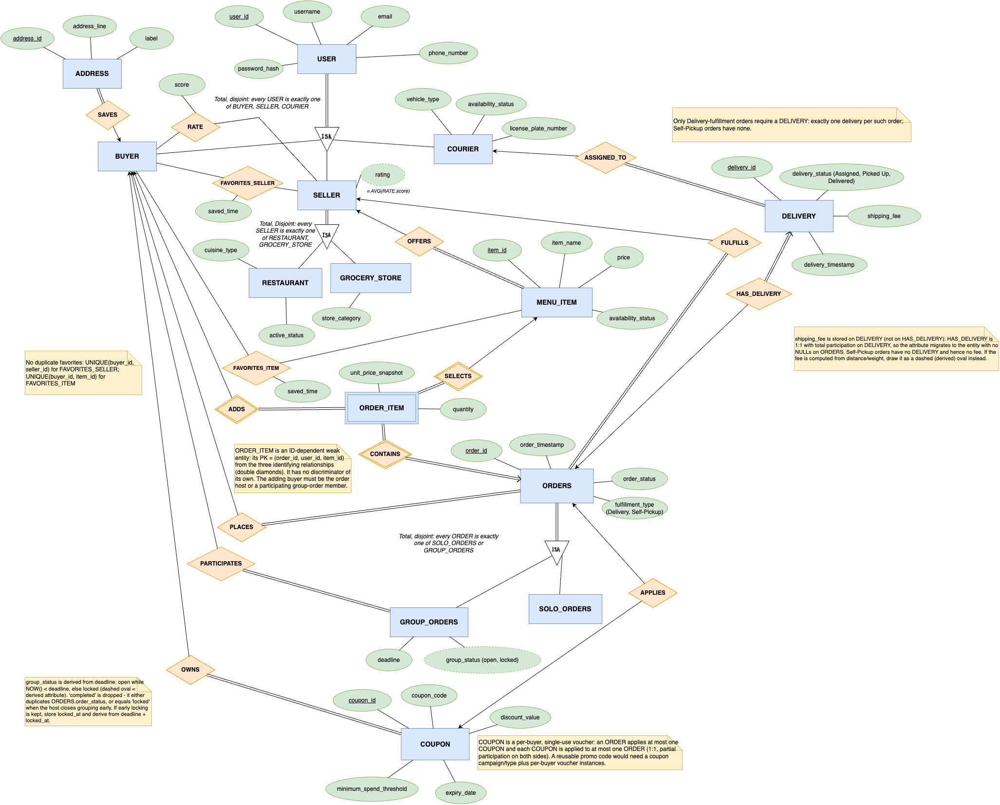

# COMP3278gp

**English** | [简体中文](README.zh-CN.md)

**Group Eats** — COMP3278 final project.

Buyers can place solo orders or create and join group orders, with each member adding their own items. The database design also covers sellers, couriers, addresses, favourites, ratings, coupons and deliveries.

## Frontend Preview

The Foodpanda-inspired mock frontend supports store browsing, menus, baskets, favourites and group-order demonstrations. From the repository root, run:

```bash
python3 -m http.server 5173 --directory frontend --bind 127.0.0.1
```

Open http://127.0.0.1:5173. The frontend uses browser-local mock data and is not connected to MySQL. Demo sign-in, friend joining and checkout do not create real transactions. See the [frontend setup and backend handoff guide](frontend/README.md).

## Task Allocation

| Task | Description | Assigned To |
|---|---|---|
| ER Diagram | Identify entities, attributes, and relationships. | Cheng Hengqi |
| Relational Schema | Define tables, keys, and constraints. | Shen Hongshan |
| Database Implementation | Set up MySQL, tables, and sample data. | Gong Jianxiang |
| Frontend, Code Review & README | Build the frontend, review code, and document setup. | Zhen Qi |
| Backend & Integration | Implement SQL and connect the frontend to MySQL. | Yang Ruizhen |

## Current Design & Progress

This README follows the [ER03 diagram](ER/ER03.png), its [editable source](ER/ER03.drawio) and the [relational schema and creation script](db/schema.sql), replacing the previous six-table design.



- The ER diagram, business descriptions, `db/schema.sql` and reproducible import script `db/setup.sh` are available.
- The current database design contains **18 tables and 2 views**. Database-backed application features still require implementation, integration and testing.
- The mock frontend is available in `frontend/`. Test fixtures are available in `db/seed.sql`; a real backend, database connectivity and configuration examples are still pending.
- `ER_Diagram_Details*.md` contains several design revisions. Resolve discrepancies against ER03 and the schema script.

## Database Design

### Tables

PK = primary key; FK = foreign key; UK = unique key.

| Table | Main fields / keys | Purpose |
|---|---|---|
| `users` | `user_id` PK, `username`, `email` UK, `phone_number`, `password_hash` | Base account information |
| `buyers` | `user_id` PK/FK → users | Buyer subtype |
| `sellers` | `user_id` PK/FK → users | Seller subtype |
| `couriers` | `user_id` PK/FK → users, `vehicle_type`, `license_plate_number`, `availability_status` | Courier subtype |
| `restaurants` | `user_id` PK/FK → sellers, `cuisine_type`, `active_status` | Restaurant subtype |
| `grocery_stores` | `user_id` PK/FK → sellers, `store_category` | Grocery-store subtype |
| `addresses` | `address_id` PK, `buyer_user_id` FK, `address_line`, `label` | Saved buyer addresses |
| `menu_items` | `item_id` PK, `seller_user_id` FK, `item_name`, `price`, `availability_status` | Items offered by a seller |
| `coupons` | `coupon_id` PK, `buyer_user_id` FK, `coupon_code`, `discount_value`, `minimum_spend_threshold`, `expiry_date` | Buyer-owned coupons |
| `orders` | `order_id` PK, `host_user_id` FK → buyers, `seller_user_id` FK → sellers, `coupon_id` UK/FK, `order_timestamp`, `order_status`, `fulfillment_type` | Shared order information; host is the placing buyer |
| `solo_orders` | `order_id` PK/FK → orders | Solo-order subtype |
| `group_orders` | `order_id` PK/FK → orders, `deadline` | Group-order subtype |
| `group_order_participants` | (`order_id`, `buyer_user_id`) composite PK/FKs | Many-to-many group membership |
| `order_items` | (`order_id`, `user_id`, `item_id`) composite PK/FKs, `quantity`, `unit_price_snapshot` | Items added by each buyer, with price snapshots |
| `favorite_sellers` | (`buyer_user_id`, `seller_user_id`) composite PK/FKs, `saved_time` | Unique buyer/seller favourites |
| `favorite_items` | (`buyer_user_id`, `item_id`) composite PK/FKs, `saved_time` | Unique buyer/item favourites |
| `seller_ratings` | (`buyer_user_id`, `seller_user_id`) composite PK/FKs, `score` | One rating per buyer/seller pair |
| `deliveries` | `delivery_id` PK, `order_id` UK/FK, `courier_user_id` FK, `delivery_status`, `delivery_timestamp`, `shipping_fee` | Delivery records and shipping fees |

### ER Rules & Implementation Notes

- **Total, disjoint ISA:** Each user is exactly one of buyer, seller or courier; each seller is exactly one of restaurant or grocery store; each order is exactly one of solo or group. Separate subtype tables are used. Foreign keys alone do not enforce completeness or exclusivity; application logic or triggers are still needed.
- **Order ownership:** `orders.host_user_id` identifies the one placing buyer (the host) and `seller_user_id` identifies the seller. Group orders connect multiple buyers through the participation table, which must also include the host. `group_order_participants.buyer_user_id` identifies all participants; it is not a second order owner column.
- **Order items:** The order, buyer and item IDs form a composite identity. `unit_price_snapshot` preserves historical prices. The backend must validate membership and ensure each item belongs to the order's seller.
- **Group status:** `group_order_status_view` derives `open` / `locked` from the deadline. Completion and cancellation use `orders.order_status`. The backend must prevent membership and item changes after the deadline. Early locking is not implemented in the database and cannot be supported by this view alone.
- **Coupons:** Each coupon belongs to one buyer. An order accepts at most one coupon, and the unique constraint on `orders.coupon_id` limits a coupon to one order. Ownership, expiry and minimum spend require backend validation.
- **Deliveries:** Each delivery references one order and one courier; an order has at most one delivery. Delivery orders require a delivery record, while self-pickup orders have none. This condition still needs business logic.
- **Ratings:** `seller_rating_view` calculates the average score rather than storing it on the seller. Scores range from 1 to 5.
- **Deletion:** Current foreign keys do not cascade deletes. Define transactional deletion of dependent records, or agree on changes to the foreign-key rules.
- **Open decisions:** Addresses are not directly linked to orders in the current schema. Agree on how order delivery addresses are selected and stored, and how coupons affect group cost allocation, before implementing those features.

### Design decisions and fixture evidence

The revisions came from three annotated review rounds kept outside this repository (`ER01问题.pdf`, `ER01问题 回应.pdf`, `Foodpanda_ER_02 问题.pdf`, `关于Foodpanda_ER_03的想法.pdf`). `db/seed.sql` is deliberately small: for each decision there is at least one row that the earlier design could not represent without loss, duplication or redundancy. Case coverage, not row count, is the criterion.

| Design decision | Raised in review | Fixture evidence | Schema object |
|---|---|---|---|
| One account = exactly one role (total, disjoint ISA) | ER01 red note "必须为 buyer/seller/courier 中的一种"; ER03 想法 §1 | 15 users split into 90001–90008 buyers, 90101–90104 sellers, 90201–90203 couriers, no overlap | `users` + three role tables |
| Surrogate `address_id`; a buyer may have 0..N addresses | ER02 问题 (same `address_line` for different buyers); ER03 想法 §2 | 90001 → 91001 + 91008; 90008 → none | `addresses` PK / FK |
| No duplicate favourites; M:N works in both directions | ER01 "一个买家不能多次收藏同一个商家"; ER03 想法 §3 | 90001 favourites 90101 and 90102; 92001 is favourited by 90001 and 90002 | composite PKs on both favourites tables |
| `rating` is derived, backed by a RATE M:N relationship | ER01 回应 ① blue `buyer — rate — seller` sketch, two old `rating` ellipses crossed out | 7 scores → 4.1667 / 4.25 / 3.75; 90104 → NULL via LEFT JOIN | `seller_ratings`, `seller_rating_view` |
| ORDER_ITEM is an ID-dependent weak entity with a three-part key | ER01 回应 green double outlines on ADDS / CONTAINS / SELECTS | 94002 and 94005: item 92001 added by two different buyers | `order_items` PK |
| `group_status` derived from deadline; `completed` belongs to `order_status` | ER01 回应 "group_status 作为 derived attribute from deadline" | 2099 / 2000 deadlines; 94009 is `locked` but still `Pending` | `group_order_status_view` |
| `shipping_fee` on DELIVERY; HAS_DELIVERY is 1:1 and partial | ER01 回应 green "shipping_fee?" circle near DELIVERY | 6 Delivery orders have exactly one delivery; 3 Self-Pickup orders have none | `deliveries.order_id UNIQUE` |
| Coupon is a per-buyer, single-use voucher (1:1 APPLIES) | ER01 回应 "really?" on coupon reuse; ER03 想法 §5 Option B | 4 coupons used once each, 93004 expired and unused, 5 orders with NULL coupon | `orders.coupon_id UNIQUE`, `coupons.buyer_user_id` |
| ORDERS supertype over solo / group orders | ER02 问题 "shared features" + hand-drawn ISA sketch; ER03 想法 §4 | 9 orders = 3 solo + 6 group sharing host, seller and status | `orders` + two subtype tables |
| Price snapshot must survive catalogue changes | ER02 问题 `unit price snapshot` | 94001 / 92003 stores 16.50 while the current price is 18.50 | `order_items.unit_price_snapshot` |
| The 0 side of participation is real | ER01 "一个骑手可接 0 或 ≥1 单"; "新卖家尚未列出菜单项" | 90203 has no deliveries; 90104 has no items and no ratings | role tables, `LEFT JOIN` in the views |

## Planned Features & CRUD Mapping

These are capabilities supported by the design, not a list of completed features. The team must confirm the final implementation scope.

| Feature | CRUD | Main tables |
|---|---|---|
| Registration / login | Create / Read | users, buyers / sellers / couriers |
| Store and item browsing, search and filters | Read | users, sellers, restaurants, grocery_stores, menu_items |
| Create solo / group orders | Create | orders, solo_orders / group_orders |
| Modify / cancel orders | Update; Delete if required | orders, group_orders and related records |
| Join / leave group orders | Create / Delete | group_order_participants |
| Add items / change quantities / remove items | Create / Update / Delete | order_items |
| View member subtotals and delivery shares | Read | order_items, group_order_participants, deliveries |
| Add / remove favourites | Create / Read / Delete | favorite_sellers, favorite_items |
| Manage item prices and availability | Update | menu_items |
| Address, rating, coupon and delivery management | To be scoped | addresses, seller_ratings, coupons, deliveries |

Item subtotals use `SUM(quantity * unit_price_snapshot)`. Shipping fees come from `deliveries.shipping_fee`; self-pickup has no delivery fee. Group allocation still requires agreed rounding and coupon rules. Complete settlement logic is not yet implemented.

### Representative SQL

```sql
-- Item subtotals per member, including members with no items; excludes shipping and coupons.
SELECT p.order_id, u.user_id, u.username,
       COALESCE(SUM(i.quantity * i.unit_price_snapshot), 0) AS item_subtotal
FROM group_order_participants p
JOIN users u ON u.user_id = p.buyer_user_id
LEFT JOIN order_items i
  ON i.order_id = p.order_id AND i.user_id = p.buyer_user_id
WHERE p.order_id = 94002
GROUP BY p.order_id, u.user_id, u.username;

-- Read group status derived from the deadline.
SELECT order_id, deadline, group_status
FROM group_order_status_view;
```

With `db/seed.sql` imported, the first query returns `90001 = 68.00` and `90002 = 112.00` (total `180.00`); the second returns three `open` and three `locked` group orders. These queries use the current schema fields but have not been executed against a live MySQL instance in this repository.

## Environment & Setup

### Database

Use MySQL **8.0.16+** so that CHECK constraints are enforced. From the repository root, run the following command. The script creates the database if needed, imports `db/schema.sql`, and prompts for the MySQL password:

```bash
bash db/setup.sh
```

Connection settings and the target database can be overridden with environment variables:

```bash
MYSQL_HOST=127.0.0.1 MYSQL_PORT=3306 MYSQL_USER=root MYSQL_DATABASE=group_eats bash db/setup.sh
```

The target database must be new and empty; `schema.sql` is not a reset script and rerunning it against existing tables will fail. Use a new `MYSQL_DATABASE` when reproducing the import. The documented import command was run successfully against the local MySQL database.

For an existing database created from the previous schema, apply the one-time column rename before importing the updated test data:

```bash
mysql -u root -p group_eats < db/migrations/001_rename_order_buyer_to_host.sql
```

The migration renames `orders.buyer_user_id` to `orders.host_user_id`; it preserves existing values and the foreign key.

#### Test Data

After creating the schema, import the test fixtures with:

```bash
bash db/seed.sh
```

The script imports 131 related test records from `db/seed.sql` into the selected database and prompts for the MySQL password. Fixtures cover multiple buyers and sellers, available and unavailable items, used and expired coupons, solo and group orders with open and locked deadlines, different order statuses, delivery and pickup, ratings, favourites, and deliveries in different stages. In group orders `94002` and `94005`, two different buyers each add the same menu item, demonstrating that an item can be selected by multiple participants in one order. Boundary cases include a buyer with two addresses and one with none, a seller with no items and no ratings, a courier with no deliveries, both directions of the favourites M:N relationships, and a historical price snapshot. See [Design decisions and fixture evidence](#design-decisions-and-fixture-evidence) for the decision each case supports; the fixture set is a coverage checklist, not a volume exercise. It uses reserved fixture IDs and upserts, so rerunning it updates the same fixture records. To select a different connection or database, use the same `MYSQL_HOST`, `MYSQL_PORT`, `MYSQL_USER` and `MYSQL_DATABASE` environment variables as `db/setup.sh`. The accounts use placeholder password hashes and are for database testing only.

### Application — Integration Pending

- The frontend uses HTML, CSS and JavaScript modules without a build step. The backend stack and dependencies are pending.
- Provide `.env.example` describing database host, port, database name and account settings.
- Add backend dependency installation, startup instructions, access URLs and demo accounts.
- Have another member reproduce the complete setup from an empty database before marking the integrated application as runnable.

Frontend development can use mock data while the team agrees on API fields, endpoints and error formats. Verify the complete workflow after connecting the real database.

## Repository Structure

```text
ER/                         ER diagrams and editable draw.io files
ER_Diagram_Details*.md       Business design revisions
Instruction/                Course requirements and references
db/schema.sql               Creation script: 18 tables and 2 views
db/setup.sh                 Reproducible database creation and schema import
db/seed.sql                 Repeatable test data for the database tables
db/seed.sh                  One-command test data import
frontend/                   Mock frontend, local assets and setup guide
README.md                   English project guide (default)
README.zh-CN.md             Simplified Chinese project guide
```

The frontend includes sample data and a separate data-access module. A real backend, related dependencies and configuration, and end-to-end database verification are still pending.
