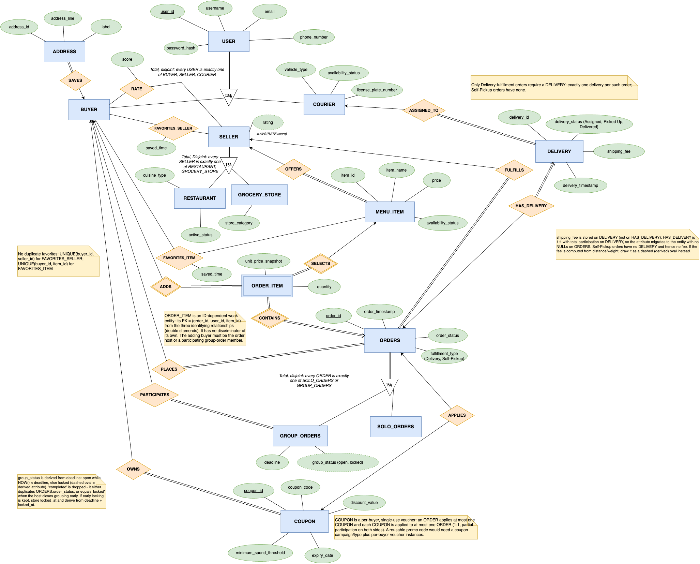

# COMP3278gp

[English](README.md) | **简体中文**

**Group Eats（foodpanda）** — COMP3278 期末项目。

买家可以下个人订单，或发起／加入拼单，各自添加商品。应用是连接 MySQL 的本地 Flask 网站。浏览器不直接连接数据库。

模式包含 **18 张表、2 个视图**。已实现登录、商家与菜单浏览、个人单与拼单、菜品增删改、收藏、优惠券、提交／取消、订单历史和模拟完成。

## 运行环境

- Python 3.10 或以上
- MySQL 8.0.16 或以上（CHECK 约束需实际生效）
- 具有建库、建表权限的 MySQL 账号

不需要 Node.js 或独立静态服务器。Flask 同时提供网页和接口。

## 1. 安装应用

**Linux / macOS / WSL：**

```bash
python3 -m venv .venv
source .venv/bin/activate
pip install -r requirements.txt
cp .env.example .env
```

**Windows PowerShell：**

```powershell
py -m venv .venv
.\.venv\Scripts\Activate.ps1
python -m pip install -r requirements.txt
Copy-Item .env.example .env
```

只在第一次复制 `.env.example`。已有 `.env` 不要覆盖。

## 2. 配置数据库连接

编辑 `.env`：

| 变量 | 用途 | 示例 |
|---|---|---|
| `SECRET_KEY` | Flask 会话密钥 | `python -c "import secrets; print(secrets.token_hex(32))"` |
| `MYSQL_HOST` | MySQL 地址 | `127.0.0.1` |
| `MYSQL_PORT` | MySQL 端口 | `3306` |
| `MYSQL_USER` | MySQL 账号 | `root` |
| `MYSQL_PASSWORD` | MySQL 密码 | 安装 MySQL 时设置的密码 |
| `MYSQL_DATABASE` | 空的目标库名 | `group_eats` |
| `PORT` | 网站端口 | `5000` |

`DELIVERY_FEE_CENTS` 默认 `1000`（HK$10.00）。`DEMO_COURIER_USER_ID` 默认 seed 骑手 `90201`。

## 3. 建表并导入样例数据

先启动 MySQL，在仓库根目录执行：

```bash
python -m backend.manage init
```

`init` 对 `.env` 中的 `MYSQL_DATABASE` 依次完成：

1. 若库不存在则创建。
2. 执行 `db/schema.sql`（18 张表、2 个视图）。
3. 导入 `db/seed.sql`（162 条互相关联的记录）。
4. 为两个演示买家写入可用密码哈希。

目标库已有表时拒绝初始化，不会清空已有应用数据库。需要从头复现时，换一个空的 `MYSQL_DATABASE` 名称。

seed 覆盖买家、商家、菜品、优惠券、个人单与拼单、收藏、评分和配送。

也可用 shell 导入（相同 schema 与 seed，再设置演示密码）：

```bash
bash db/setup.sh
bash db/seed.sh
python -m backend.manage demo-accounts
```

`setup.sh` 和 `seed.sh` 会提示输入 MySQL 密码。只导入 `seed.sql` 时密码仍是占位哈希，需再运行 `demo-accounts`。

## 4. 启动网站

```bash
python app.py
```

打开 **http://127.0.0.1:5000**。

若该地址不是本网站（部分 macOS 上 5000 被 AirPlay 占用），在 `.env` 中设置 `PORT=5001`，重新运行 `python app.py`，打开 **http://127.0.0.1:5001**。

使用期间保持该终端运行。Ctrl+C 停止。

### 演示账号

仅供本地课程演示：

| 买家 | 邮箱 | 密码 |
|---|---|---|
| Alice | alice@example.com | DemoPass3278! |
| Bob | bob@example.com | DemoPass3278! |

没有注册功能。普通窗口用 Alice，无痕窗口用 Bob，才能同时操作同一拼单。同一浏览器两个普通标签共享登录。

Alice 未用券码为 `ALICE10`（满 HK$30），Bob 为 `BOB5`。在待提交订单上填写。拼单由 host 用券，只从 host 应付中扣除。拼单截止后，host 仍可从 Pending 订单上移除优惠券再提交；加券、换券和改菜仍要求拼单未截止。

## 5. 查看数据

网页操作之后查询 MySQL。结果不会自动刷新，需要再次执行 SELECT。

**MySQL Workbench：** 用与 `.env` 相同的地址 `127.0.0.1:3306`、账号、密码和库名连接。新建 SQL 窗口执行：

```sql
SELECT DATABASE();
SHOW TABLES;
SELECT order_id, host_user_id, order_status, coupon_id
FROM orders
WHERE host_user_id = 90001
ORDER BY order_id DESC
LIMIT 10;
SELECT buyer_user_id, seller_user_id, saved_time
FROM favorite_sellers
WHERE buyer_user_id = 90001;
```

Alice 的 `user_id` 为 `90001`。Harbour Cafe 为商家 `90101`。

**MySQL 命令行：**

```bash
mysql -h 127.0.0.1 -P 3306 -u root -p group_eats
```

主机、端口、账号和库名以自己的 `.env` 为准。

## 6. 测试

虚拟环境已激活、MySQL 已运行、`.env` 已配置时：

```bash
python -m unittest discover -s tests -v
```

测试会创建临时库 `group_eats_test_*`，导入真实 schema 和 seed，结束后删除该测试库，不清空 `MYSQL_DATABASE`。账号需要 `CREATE` 与 `DROP DATABASE` 权限。共 26 项集成测试。

## 使用说明

1. 以 Alice 登录。
2. 打开一家店（页面读取 seed 中的 4 家商家、9 个商品）。
3. **Order for myself** 创建个人单，**Start a group order** 创建带截止时间的拼单。
4. 添加、修改或删除菜品。提交订单，或在提交前取消。
5. 拼单复制邀请链接，无痕窗口用 Bob 登录后加入并添加 Bob 自己的菜。
6. 爱心收藏商家和菜品。优惠券在 Coupons 中查看，在待提交订单上使用。

取消保留订单记录，并将 `coupon_id` 设为 NULL。已提交订单只读。Pending 拼单在截止时间（香港时间）后不可再加入或改菜。host 可在截止前或后对非空拼单提交。提交不是在线支付。

## 数据库设计

当前模式以 [ER03](ER/ER03.png)（[draw.io 源文件](ER/ER03.drawio)）和 `db/schema.sql` 为准。



| 表 | 用途 |
|---|---|
| `users`, `buyers`, `sellers`, `couriers` | 账号；每个用户恰好一种角色 |
| `restaurants`, `grocery_stores` | 商家子类 |
| `addresses` | 买家地址（结账时不选择） |
| `menu_items` | 商家菜单 |
| `coupons` | 买家优惠券；一单最多一张 |
| `orders`, `solo_orders`, `group_orders` | 订单头与子类 |
| `group_order_participants` | 拼单成员 |
| `order_items` | 明细，含 `unit_price_snapshot` |
| `favorite_sellers`, `favorite_items` | 收藏 |
| `seller_ratings` | 每对买家／商家一条评分；均值见 `seller_rating_view` |
| `deliveries` | 一单最多一条配送；自取没有配送记录 |
| `group_order_status_view` | 由截止时间得到 `open` / `locked` |

### 已实现操作

| 功能 | SQL 作用 | 表 |
|---|---|---|
| 登录与目录 | Read | `users`, `buyers`, `sellers`, `menu_items` |
| 创建个人单／拼单 | Create | `orders`, `solo_orders` / `group_orders`, `deliveries` |
| 加入／退出拼单 | Create / Delete | `group_order_participants`, `order_items` |
| 加菜／改数量／删菜 | Create / Update / Delete | `order_items` |
| 提交／取消 | Update | `orders`（取消时清空 `coupon_id`） |
| 收藏 | Create / Read / Delete | `favorite_sellers`, `favorite_items` |
| 使用／移除优惠券 | Update | `orders`, `coupons` |

未实现：注册、结账选地址、在线支付、商家或骑手界面。

### 样例查询（`init` 之后）

```sql
SELECT p.order_id, u.user_id, u.username,
       COALESCE(SUM(i.quantity * i.unit_price_snapshot), 0) AS item_subtotal
FROM group_order_participants p
JOIN users u ON u.user_id = p.buyer_user_id
LEFT JOIN order_items i
  ON i.order_id = p.order_id AND i.user_id = p.buyer_user_id
WHERE p.order_id = 94002
GROUP BY p.order_id, u.user_id, u.username;

SELECT order_id, deadline, group_status
FROM group_order_status_view;
```

第一条返回 `90001 = 68.00`、`90002 = 112.00`。第二条返回 6 个 `open`、3 个 `locked` 拼单。

## 分工

| 任务 | 说明 | 负责人 |
|---|---|---|
| ER Diagram | 实体、属性和联系 | Cheng Hengqi |
| Relational Schema | 表、键和约束 | Shen Hongshan |
| Database Implementation | MySQL、建表和样例数据 | Gong Jianxiang |
| Frontend, Code Review & README | 前端、代码审阅和说明文档 | Zhen Qi |
| Backend & Integration | SQL 实现并将前端连接到 MySQL | Yang Ruizhen |

## 仓库结构

```text
ER/                 ER03 图与 draw.io 源文件
db/schema.sql       18 张表、2 个视图
db/seed.sql         162 条 seed 记录
db/setup.sh         可选 schema 导入
db/seed.sh          可选 seed 导入
backend/            Flask 接口与 SQL
app.py              启动入口
requirements.txt    Python 依赖
.env.example        连接配置模板（复制为 .env；不要提交 .env）
tests/              MySQL 集成测试
frontend/           网页与本地图片
docs/               接口约定
```

## 已有数据库

库中已是当前表结构时，不要运行 `init`。用：

```bash
python -m backend.manage seed
```

更新样例并准备演示密码，或用 `python -m backend.manage demo-accounts` 只更新 Alice 和 Bob。演示过程中不要重新 seed。

若库由旧版 schema 创建，执行一次：

```bash
python -m backend.manage migrate
```

该命令将创建时间字段改名为 `created_at`，添加完成时间列，并在缺失时插入演示券 `ALICE10`、`BOB5`。已有优惠券、订单和密码保留。重复执行 `migrate` 不会重复发券。
