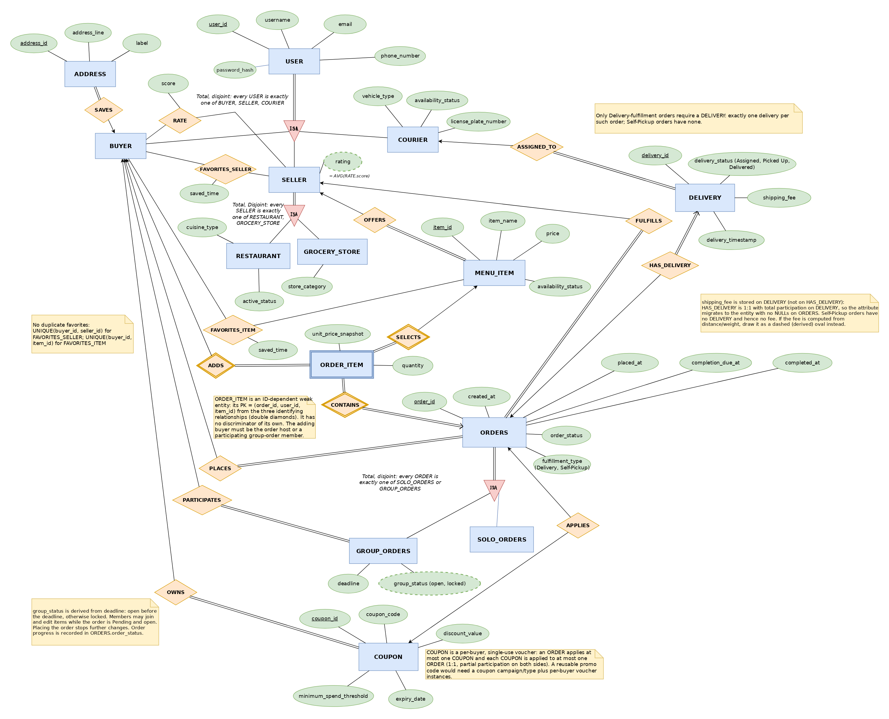

# COMP3278gp

[English](README.md) | **简体中文**

**foodpanda（拼单外卖）** — COMP3278 final project.

买家可以下个人订单，也可以发起或加入拼单，各自添加商品。数据库设计还涵盖商家、骑手、地址、收藏、评分、优惠券和配送。

## 运行完整应用

需要 Python 3.10+ 和运行中的 MySQL 8.0.16+（本次用 MySQL 8.4.7 验证）。Flask 同时提供网页和接口，不需要 npm 或独立静态服务器。

**Linux / macOS / WSL 首次准备：**

```bash
python3 -m venv .venv
source .venv/bin/activate
pip install -r requirements.txt
cp .env.example .env
```

**Windows PowerShell 首次准备：**

```powershell
py -m venv .venv
.\.venv\Scripts\Activate.ps1
python -m pip install -r requirements.txt
Copy-Item .env.example .env
```

已有 ER03 数据库先运行 `python -m backend.manage migrate`，将旧创建时间字段改名为 `created_at` 并添加完成时间字段及索引，保留现有数据。

配置模板只在第一次复制，已有 `.env` 不要覆盖。两种系统的配置和测试方法相同。

**所有平台都需要配置：** 修改 `.env` 的 MySQL 地址、端口、账号、密码和新的空数据库名。用 `python -c "import secrets; print(secrets.token_hex(32))"` 生成私有 SECRET_KEY。MySQL 账号需要建库、建表权限，也可提前建立空数据库。

```bash
python -m backend.manage init
python app.py
```

打开 http://127.0.0.1:5000。init 创建表、导入原有 160 条 seed 数据，为两个测试买家设置可用密码哈希。目标已有表时拒绝初始化，不会清空原数据库。

| 买家 | 邮箱 | 密码（仅本地课程演示） |
|---|---|---|
| Alice | alice@example.com | DemoPass3278! |
| Bob | bob@example.com | DemoPass3278! |

数据库已是最新表结构时，可运行 `python -m backend.manage seed` 更新样例并准备演示账号，或用 `python -m backend.manage demo-accounts` 只更新两个账号的密码哈希。seed 会恢复样例值，不要在演示中途重导。旧表使用 orders.buyer_user_id 时，先执行下方迁移。原 shell 导入脚本仍可使用；直接导入 seed.sql 会恢复占位密码，需再运行 demo-accounts。

从商家菜单创建拼单，复制邀请链接，在另一浏览器配置／无痕窗口用另一个账号加入并加菜、改数量、删除。同一浏览器两个普通标签共享登录。详情每 15 秒刷新，也可手动刷新。

配送拼单运费取服务器 DELIVERY_FEE_CENTS（默认 1000 分），DEMO_COURIER_USER_ID 指向 Available 的 seed 骑手（默认 90201）。创建拼单和配送记录在一个事务完成，这是演示简化派单，不是真实配送。0 运费合法，自取没有配送记录；已有订单使用已存运费。均摊余数归 host。所有金额均为优惠券前金额，不是最终支付账单。

真实页面读取 seed 的 4 家商家、9 个商品，图片是本地展示素材。第一阶段未实现在线支付、收藏、地址、优惠券、商家／骑手界面。不提供提前锁单；Pending 拼单到截止时间自动只读，使用香港时间。取消保留历史记录。

[前端说明](frontend/README.zh-CN.md) · [接口约定](docs/API.zh-CN.md) · [English contract](docs/API.md)

## Task Allocation

| Task | Description | Assigned To |
|---|---|---|
| ER Diagram | Identify entities, attributes, and relationships. | Cheng Hengqi |
| Relational Schema | Define tables, keys, and constraints. | Shen Hongshan |
| Database Implementation | Set up MySQL, tables, and sample data. | Gong Jianxiang |
| Frontend, Code Review & README | Build the frontend, review code, and document setup. | Zhen Qi |
| Backend & Integration | Implement SQL and connect the frontend to MySQL. | Yang Ruizhen |

## Current Design & Progress

ER03 可编辑图及导出图片已补充 orders 的 `placed_at`、`completion_due_at`、`completed_at`，并区分截止时间状态和订单状态；详见 [最新设计说明](ER_Diagram_Details04.md)。

当前 README 以 [ER03 图](ER/ER03.png)、[可编辑文件](ER/ER03.drawio) 和 [关系模式及建表脚本](db/schema.sql) 为依据，替代旧的六张表方案。



- 已有 ER 图、业务说明、`db/schema.sql` 和可复现导入脚本 `db/setup.sh`
- 数据库设计为 **18 张表、2 个视图**，第一阶段只使用其中部分，存在表不代表所有功能均实现。
- 已接入 Flask/MySQL 后端，支持登录、商家菜单、拼单创建／加入／退出、自己的菜品 CRUD、金额查询和 host 取消。运行见上方。
- `ER_Diagram_Details*.md` 保留了多版说明；出现冲突时，应与 ER03 和建表脚本核对后统一。

## Database Design

### Tables

PK = 主键，FK = 外键，UK = 唯一键。

| Table | Main fields / keys | Purpose |
|---|---|---|
| `users` | `user_id` PK, `username`, `email` UK, `phone_number`, `password_hash` | 账户基础信息 |
| `buyers` | `user_id` PK/FK → users | 买家角色 |
| `sellers` | `user_id` PK/FK → users | 商家角色 |
| `couriers` | `user_id` PK/FK → users, `vehicle_type`, `license_plate_number`, `availability_status` | 骑手角色 |
| `restaurants` | `user_id` PK/FK → sellers, `cuisine_type`, `active_status` | 餐厅子类 |
| `grocery_stores` | `user_id` PK/FK → sellers, `store_category` | 杂货店子类 |
| `addresses` | `address_id` PK, `buyer_user_id` FK, `address_line`, `label` | 买家保存的地址 |
| `menu_items` | `item_id` PK, `seller_user_id` FK, `item_name`, `price`, `availability_status` | 商家提供的商品 |
| `coupons` | `coupon_id` PK, `buyer_user_id` FK, `coupon_code`, `discount_value`, `minimum_spend_threshold`, `expiry_date` | 买家拥有的优惠券 |
| `orders` | `order_id` PK, `host_user_id` FK → buyers, `seller_user_id` FK → sellers, `coupon_id` UK/FK, `created_at`, `order_status`, `fulfillment_type`, `placed_at`, `completion_due_at`, `completed_at` | 订单公共信息；host 是下单发起人 |
| `solo_orders` | `order_id` PK/FK → orders | 个人订单子类 |
| `group_orders` | `order_id` PK/FK → orders, `deadline` | 拼单子类 |
| `group_order_participants` | (`order_id`, `buyer_user_id`) composite PK/FKs | 买家参与拼单的多对多关系 |
| `order_items` | (`order_id`, `user_id`, `item_id`) composite PK/FKs, `quantity`, `unit_price_snapshot` | 每位买家添加的商品及价格快照 |
| `favorite_sellers` | (`buyer_user_id`, `seller_user_id`) composite PK/FKs, `saved_time` | 商家收藏，禁止重复 |
| `favorite_items` | (`buyer_user_id`, `item_id`) composite PK/FKs, `saved_time` | 商品收藏，禁止重复 |
| `seller_ratings` | (`buyer_user_id`, `seller_user_id`) composite PK/FKs, `score` | 每位买家对每个商家的评分 |
| `deliveries` | `delivery_id` PK, `order_id` UK/FK, `courier_user_id` FK, `delivery_status`, `delivery_timestamp`, `shipping_fee` | 配送记录及运费 |

### ER Rules & Implementation Notes

- **ISA（total, disjoint）**：每个用户恰为买家、商家、骑手之一；每个商家恰为餐厅、杂货店之一；每个订单恰为个人单、拼单之一。采用独立子类表；当前外键本身不能保证完全且互斥，仍需应用逻辑或触发器维护。
- **订单归属**：`orders.host_user_id` 记录唯一的下单发起人（团长），`seller_user_id` 记录商家。拼单通过参与表关联多位买家，且团长也必须加入参与表。`group_order_participants.buyer_user_id` 表示所有参与者，不是订单的第二个归属字段。
- **订单明细**：由订单、买家、商品三个编号联合标识，保存 `unit_price_snapshot`，避免菜单改价影响历史金额。后端已检查添加者资格和商品所属商家。
- **拼单状态**：`group_order_status_view` 按截止时间派生 `open` / `locked`；完成或取消等业务状态使用 `orders.order_status`。后端已阻止截止后的成员和明细修改。没有独立手动锁单功能；提前提交通过 Confirmed 状态停止修改。
- **优惠券**：每张券归属一位买家；订单最多使用一张，`orders.coupon_id` 唯一约束限制同一券最多关联一个订单。有效期、满减门槛和使用人需由后端校验。
- **配送**：每条配送记录关联一个订单和一个骑手；订单最多一条配送记录。仅配送订单需要记录，自取订单没有配送记录，新拼单创建接口已维护此条件。
- **评分**：`seller_rating_view` 计算商家平均分，不在商家表重复保存。分数范围为 1–5。
- **删除**：当前外键没有配置级联删除，不能假设删除订单会自动清理明细。应明确采用事务按顺序删除关联记录，或经讨论后修改外键规则。
- **待明确的规则**：当前地址表没有与订单直接关联；订单收货地址如何选择和保存，以及优惠券如何影响拼单分摊，需在相关功能实现前确定。

### Design decisions and fixture evidence

设计修订来自仓库外保存的三轮批注讨论（`ER01问题.pdf`、`ER01问题 回应.pdf`、`Foodpanda_ER_02 问题.pdf`、`关于Foodpanda_ER_03的想法.pdf`）。`db/seed.sql` 刻意保持精简：每个设计决策都至少有一行数据，是旧设计无法表达、会丢失或会冗余的反例。衡量标准是**情况覆盖度，不是数据条数**。

| 设计决策 | 讨论出处 | 样例数据证据 | 对应模式对象 |
|---|---|---|---|
| 一个账号恰对应一个角色（total, disjoint ISA） | ER01 红字「必须为 buyer/seller/courier 中的一种」；ER03 想法 §1 | 15 个用户分为 90001–90008 买家、90101–90104 商家、90201–90203 骑手，无交集 | `users` + 三张角色表 |
| 代理主键 `address_id`；买家可有 0..N 个地址 | ER02 问题（不同买家可同地址文本）；ER03 想法 §2 | 90001 有 91001 与 91008；90008 没有地址 | `addresses` PK / FK |
| 收藏不重复，且 M:N 两侧都成立 | ER01「一个买家不能多次收藏同一个商家」；ER03 想法 §3 | 90001 收藏 90101 与 90102；92001 被 90001 与 90002 收藏 | 两张收藏表的复合主键 |
| `rating` 为派生属性，底层是 RATE M:N 关系 | ER01 回应 ① 蓝色 `buyer — rate — seller` 草图，划掉两个旧 `rating` 椭圆 | 7 个评分 → 4.1667 / 4.25 / 3.75；90104 经 LEFT JOIN 得 NULL | `seller_ratings`、`seller_rating_view` |
| ORDER_ITEM 为 ID-dependent 弱实体，三段式标识键 | ER01 回应中 ADDS / CONTAINS / SELECTS 的绿色双线 | 94002 与 94005 中，92001 由两位不同买家各自添加 | `order_items` 复合主键 |
| `group_status` 由截止时间派生，`completed` 归入 `order_status` | ER01 回应「group_status 作为 derived attribute from deadline」 | 2099 / 2000 两个截止时间；94009 已 `locked` 但仍是 `Pending` | `group_order_status_view` |
| `shipping_fee` 挂在 DELIVERY；HAS_DELIVERY 为 1:1 且部分参与 | ER01 回应 DELIVERY 旁绿色「shipping_fee?」圈注 | 10 个配送单各有一条配送；3 个自取单没有；其中一条配送费为 `$0.00` | `deliveries.order_id UNIQUE` |
| 优惠券是每位买家的一次性券（APPLIES 1:1） | ER01 回应「really?」质疑券复用；ER03 想法 §5 方案 B | 4 张券各用一次、93004 过期未用、5 个订单 `coupon_id` 为 NULL | `orders.coupon_id UNIQUE`、`coupons.buyer_user_id` |
| ORDERS 作为个人单 / 拼单的父类 | ER02 问题「shared features」与手绘 ISA 草图；ER03 想法 §4 | 13 个订单 = 4 个个人单 + 9 个拼单，共用 host、商家、状态字段 | `orders` + 两张子类表 |
| 拼单费用分摊覆盖参与人数边界 | ER03 特殊情况 sample data 建议 §2 | 94101 / 94102 / 94103 分别有 1 / 3 / 4 名参与者，配送费为 `$10.00` / `$10.00` / `$10.02` | `group_order_participants`、`deliveries.shipping_fee` |
| 价格快照不受菜单改价影响 | ER02 问题 `unit price snapshot` | 94001 / 92003 保存 16.50，而当前价为 18.50 | `order_items.unit_price_snapshot` |
| 参与约束的「0」侧真实存在 | ER01「一个骑手可接 0 或 ≥1 单」「新卖家尚未列出菜单项」 | 90203 无配送；90104 无商品、无评分 | 角色表、视图中的 `LEFT JOIN` |

## 已实现功能与 CRUD 对照

| 功能 | CRUD | 主要表 |
|---|---|---|
| 买家登录、浏览商家菜单 | Read | users, buyers, sellers, menu_items |
| 创建个人单／拼单草稿 | Create | orders, solo_orders / group_orders, deliveries |
| 加入／退出拼单 | Create / Delete | group_order_participants, order_items |
| 加菜／改数量／删菜 | Create / Read / Update / Delete | order_items |
| 成员餐费、运费均摊与订单历史 | Read | orders, order_items, group_order_participants, deliveries |
| 提交／取消草稿，模拟完成 | Update | orders, deliveries |

取消保留历史；删除菜品和退出拼单会实际执行 DELETE。餐费使用 `SUM(quantity * unit_price_snapshot)`，运费按整数分均摊、余数归 host，自取无运费。注册、收藏、地址／优惠券管理、商家工具和在线支付尚未实现。

### Representative SQL

```sql
-- 拼单中每位买家的商品金额（不含运费及优惠券），包含尚未加菜的成员。
SELECT p.order_id, u.user_id, u.username,
       COALESCE(SUM(i.quantity * i.unit_price_snapshot), 0) AS item_subtotal
FROM group_order_participants p
JOIN users u ON u.user_id = p.buyer_user_id
LEFT JOIN order_items i
  ON i.order_id = p.order_id AND i.user_id = p.buyer_user_id
WHERE p.order_id = 94002
GROUP BY p.order_id, u.user_id, u.username;

-- 读取按截止时间计算的拼单状态。
SELECT order_id, deadline, group_status
FROM group_order_status_view;
```

导入 `db/seed.sql` 后，第一条查询应返回 `90001 = 68.00`、`90002 = 112.00`（合计 `180.00`）；第二条返回 6 个 `open` 和 3 个 `locked` 拼单。已在 MySQL 8.4.7 上导入原始 seed 后核对这些结果。

## Environment & Setup

### Database

要求 MySQL **8.0.16+**，以支持脚本中实际生效的 CHECK 约束。从仓库根目录运行以下命令；脚本会创建数据库（如尚不存在），导入 `db/schema.sql`，并提示输入 MySQL 密码：

```bash
bash db/setup.sh
```

可通过环境变量指定连接信息和目标库，例如：

```bash
MYSQL_HOST=127.0.0.1 MYSQL_PORT=3306 MYSQL_USER=root MYSQL_DATABASE=group_eats bash db/setup.sh
```

目标数据库必须是新建的空库；`schema.sql` 不是重置脚本，在已建表的库上重复运行会报错。需要重新验证时，请改用一个新的 `MYSQL_DATABASE`。上述建表命令已在本机 MySQL 数据库成功运行。

若数据库已由旧版 schema 建立，重新导入新版测试数据前需执行一次列名迁移：

```bash
mysql -u root -p group_eats < db/migrations/001_rename_order_buyer_to_host.sql
```

该迁移会将 `orders.buyer_user_id` 改名为 `orders.host_user_id`，保留已有数据和外键。

#### 测试数据

建表完成后，运行以下命令导入测试数据：

```bash
bash db/seed.sh
```

脚本会将 160 条相互关联的测试记录从 `db/seed.sql` 导入选定数据库，并提示输入 MySQL 密码。数据覆盖多个买家和商家、在售及停售商品、已使用及过期优惠券、个人单和不同截止状态的拼单、多种订单状态、配送和自取、评分、收藏及不同配送进度。在拼单 `94002` 和 `94005` 中，不同买家都添加了同一个菜品，体现同一拼单中多人可选择相同菜品的情况。拼单 `94101`–`94103` 覆盖 1、3、4 人参与及配送费余数分摊；个人单 `94104` 覆盖零运费配送。其他边界情况包括：有 2 个地址的买家与 0 个地址的买家、无商品且无评分的商家、无配送记录的骑手、收藏关系 M:N 的两个方向，以及与当前价不同的历史价格快照。各情况支撑哪项设计决策见 [Design decisions and fixture evidence](#design-decisions-and-fixture-evidence)；这批数据是覆盖清单，不追求条数。数据使用专用 ID 和 upsert，重复运行会更新同一批测试记录，不会重复新增。可使用与 `db/setup.sh` 相同的 `MYSQL_HOST`、`MYSQL_PORT`、`MYSQL_USER` 和 `MYSQL_DATABASE` 环境变量指定连接信息。测试账号的密码哈希是占位值，仅用于数据库测试。

### 使用 MySQL 命令行查看数据

保持 MySQL 运行，另开一个终端。连接参数以自己 `.env` 的地址、端口、账号和数据库名为准。一般有密码的安装可以这样连接：

```bash
mysql -h 127.0.0.1 -P 3306 -u root -p group_eats
```

Kelly 当前这台 WSL 电脑准备的临时实例使用 **33307** 端口、**group_eats_local** 数据库，root 密码为空，因此使用：

```bash
mysql -h 127.0.0.1 -P 33307 -u root group_eats_local
```

第二条只是本机配置，不要求其他组员照搬。数据库必须已启动；本机准备的启动脚本会与网站一起启动数据库。其他电脑如果没有 mysql 命令，需要安装 MySQL 命令行客户端，或用 MySQL Workbench 查看。

进入 `mysql>` 后执行：

```sql
SELECT DATABASE();
SHOW TABLES;
SELECT order_id, host_user_id, order_status, fulfillment_type
FROM orders ORDER BY order_id DESC LIMIT 10;
SELECT order_id, user_id, item_id, quantity, unit_price_snapshot
FROM order_items ORDER BY order_id DESC, user_id, item_id LIMIT 20;
```

在网页加菜、改数量或删除后，重新执行 SELECT 就能看到变化。查询结果不会自动刷新。只看某一笔订单时，把示例编号换成网页显示的订单编号：

```sql
SELECT * FROM order_items WHERE order_id = 94102;
```

退出输入 `exit;`、`quit;` 或按 Ctrl+D。只退出客户端，不会停止数据库或删除数据。

### 验证方法

Linux、macOS、WSL 和 Windows 都可以测试。先按上方对应命令激活虚拟环境；MySQL 运行且 .env 配置好后：

```bash
python -m unittest discover -s tests -v
```

手动验收：普通浏览器用 Alice，无痕窗口用 Bob，依次创建、加入、加菜、改数量、删除，刷新两个窗口确认一致，再测试退出、取消。打开已截止的 seed 拼单确认只读；核对 94102／94103 的运费余数及零运费配置。最后请另一位成员在新数据库按首次步骤复现。

测试创建随机命名的 group_eats_test_* 数据库，导入真实 schema/seed，完成后只删除该测试库，不清空应用数据库。测试账号需要建库、删库权限。19 项集成测试已在 MySQL 8.4.7 上通过；两个独立 Chromium 会话也已通过创建、加入、加菜、改数量、移除、退出、取消、刷新保存和手机布局检查。覆盖真实 CRUD、session/CSRF、成员隔离、历史价格快照、并发加入、取消、截止时间、零运费／自取、余数、事务回滚及创建时间字段迁移。

另用 Alice、Bob 两个独立浏览器窗口走完整流程，对照 MySQL 确认新增、修改和删除已保存，检查非成员不能改菜、截止和取消后只读。这是小组验收前准备，不代表 slides 和视频已经完成。

## Repository Structure

```text
ER/                         ER 图与可编辑 draw.io 文件
ER_Diagram_Details*.md       多版业务设计说明
Instruction/                课程要求与参考资料
db/schema.sql               当前 18 张表、2 个视图的建表脚本
db/setup.sh                 创建数据库并导入 schema.sql 的可复现脚本
db/seed.sql                 可重复导入的数据库测试数据
db/seed.sh                  一键导入测试数据
backend/                    Flask 接口、业务 SQL 和数据库初始化工具
app.py                      网页与后端的统一入口
requirements.txt            Python 依赖
.env.example                本地配置模板
tests/test_api.py           真实 MySQL 集成测试
docs/                       英中接口约定
frontend/                   数据库驱动的前端与本地素材
README.md                   英文说明（默认）
README.zh-CN.md             中文说明
```

`frontend/` 已接真实 API；旧 mock 样例不参与真实页面。接下来进行小组独立验收，并准备展示和视频。

应用入口为 `app.py`，后端及数据库管理在 `backend/`，依赖见 `requirements.txt`，配置模板为 `.env.example`，真实 MySQL 集成测试在 `tests/test_api.py`。真实前端不自动退回 mock 数据。

提交订单：host 在已有菜品时可随时点击 Place group order，将 Pending 更新为 Confirmed。提交后只读；不收取在线支付、不发起真实配送。创建时可选 1 分钟截止。已有数据库可运行 `python -m backend.manage refresh-labels` 仅替换预留样例名称和邮箱，保留订单、价格与密码，不要为改名重新 seed。

账号菜单现为 Orders，提供 All orders、Group orders、Individual orders 分类。个人单支持创建、加菜、改数量、删除和立即提交，提交后只读；没有个人单时显示空状态。登录邮箱默认空白，只显示 Email address 提示。

个人下单：打开商家 → Order for myself → 选择配送／自取 → 加菜、改数量 → Place order。个人单可以立即提交，拼单 host 也可在大家准备好后提前提交。Orders 分类显示数量，只列当前登录账号的记录。

Deadline 是加入和改菜的时间上限，不是最早提交时间。Host 可在截止前或后提交非空 Pending 拼单。提交使用现有 order_status=Confirmed，立即禁止所有成员和菜品修改；提前提交本身不需要独立锁单字段；模拟完成另增加下文的三个时间字段。提前提交后，纯时间派生的 group_status 仍可能为 open，因此权限必须同时检查 order_status。

## 订单状态与自动完成

- Pending：草稿。个人单可编辑；拼单只有截止前可加入、退出和改菜。非空订单可由个人单拥有者／拼单 host 提交，拼单不必等截止时间。
- Confirmed：已提交，菜品和成员只读。提交事务保存 placed_at，并随机选择 15–60 分钟后的 completion_due_at；重复提交保留原时间。
- Completed：后台到期自动完成，写 completed_at；配送记录同时改为 Delivered，自取没有配送记录。
- Cancelled：提交前取消，保留记录，不进入自动完成。seed 中的 In Progress 是历史状态，本模拟不自动迁移它。

已有数据库先运行 `python -m backend.manage migrate`，它可重复执行，将旧创建时间字段改名为 `created_at`，并添加三个完成时间字段和索引，不清空订单和密码。首次 init 已包含新结构。历史 Confirmed 订单没有预计时间时不自动回填或完成；只对新提交、或重新确认并建立计划的订单计时。

`python app.py` 会启动后台检查线程，每 5 秒检查一次，不需要打开网页；服务器停机时暂停，重启后补处理已到期订单。页面每 15 秒刷新，状态显示可能稍晚。预计和实际完成时间保存在数据库，重启不重新抽取。若通过其他 WSGI 服务启动网页，另运行 `python -m backend.completion`。这是课程模拟，不代表真实派送或支付。

本地开发默认自动重载 Python 代码（APP_RELOAD=1），不启用交互式调试器。首次升级仍需重启旧进程。界面里的 Add food before placing 只在确实没有菜品时显示，已加菜却不能提交应检查登录身份、订单状态及后端版本。
